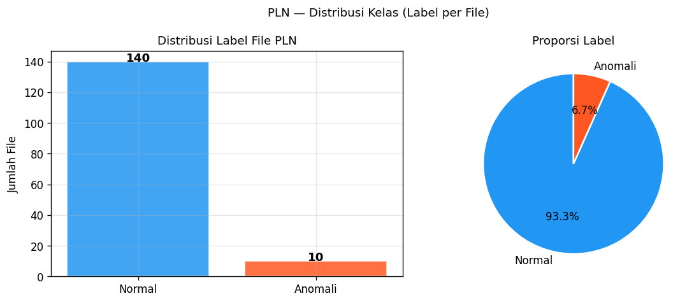
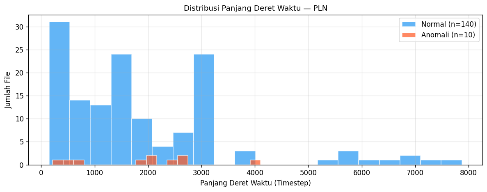
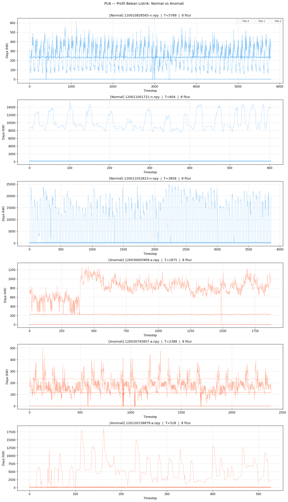
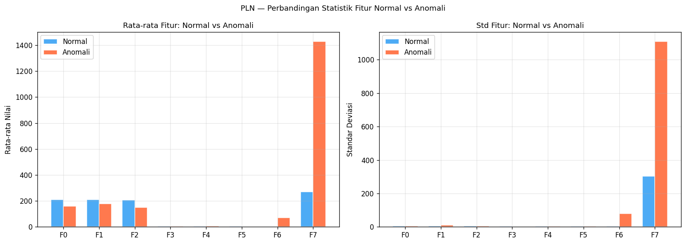
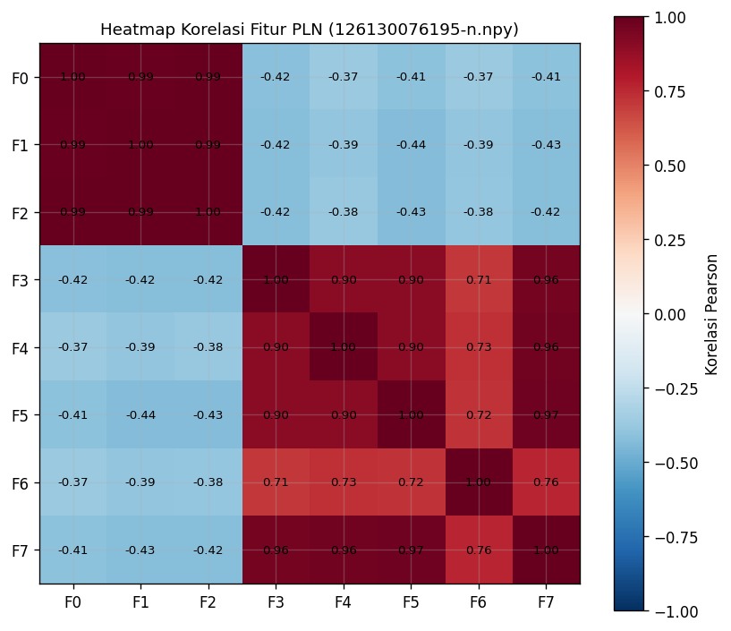
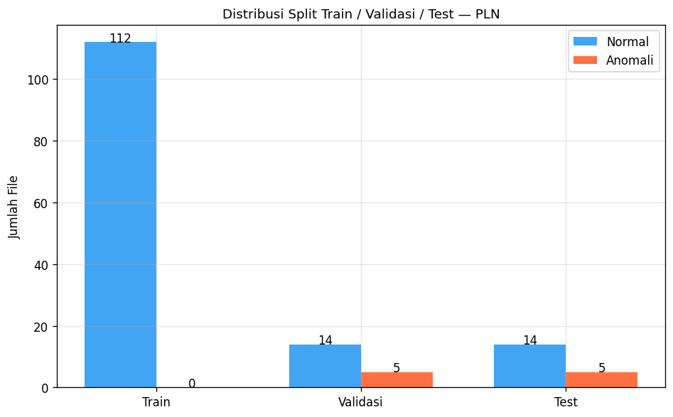

# Exploratory Data Analysis — PLN (Profil Beban Listrik PLN)
Dataset PLN berisi data load profile pelanggan listrik PT PLN. Setiap file merepresentasikan satu pelanggan dengan data deret waktu konsumsi daya dalam interval 30 menit (atau 1 jam). Label anomali bersifat **per file** (bukan per timestep), sehingga satu file dinyatakan normal (0) atau anomali (1) secara keseluruhan.


```python
import numpy as np
import pandas as pd
import matplotlib.pyplot as plt
import matplotlib.patches as mpatches
import matplotlib.gridspec as gridspec
from pathlib import Path
import ast, warnings, os
warnings.filterwarnings('ignore')

plt.rcParams.update({
    'figure.dpi': 120,
    'font.size': 10,
    'axes.titlesize': 11,
    'axes.labelsize': 10,
    'lines.linewidth': 0.9,
    'axes.grid': True,
    'grid.alpha': 0.3,
})

BASE = Path(r'D:\CARLA')
COLORS = {'normal': '#2196F3', 'anomaly': '#FF5722', 'val': '#4CAF50'}

# Buat folder output jika belum ada
FIG_DIR = BASE / 'results' / 'figures'
FIG_DIR.mkdir(parents=True, exist_ok=True)
print(f'Setup selesai. Output gambar: {FIG_DIR}')

```

    Setup selesai. Output gambar: D:\CARLA\results\figures
    

## 1. Memuat Daftar File dan Label


```python
DATA_DIR = BASE / 'datasets' / 'PLN' / 'processed'

file_labels = pd.read_csv(DATA_DIR / 'file_labels.csv')
print(f"Total file : {len(file_labels)}")
print(f"\nDistribusi label:")
print(file_labels['label'].value_counts().rename({0: 'Normal (0)', 1: 'Anomali (1)'}).to_string())
print()
display(file_labels.head(10))

```

    Total file : 150
    
    Distribusi label:
    label
    Normal (0)     140
    Anomali (1)     10
    
    


<div>
<style scoped>
    .dataframe tbody tr th:only-of-type {
        vertical-align: middle;
    }

    .dataframe tbody tr th {
        vertical-align: top;
    }

    .dataframe thead th {
        text-align: right;
    }
</style>
<table border="1" class="dataframe">
  <thead>
    <tr style="text-align: right;">
      <th></th>
      <th>fname</th>
      <th>label</th>
    </tr>
  </thead>
  <tbody>
    <tr>
      <th>0</th>
      <td>120030005909-a.npy</td>
      <td>1</td>
    </tr>
    <tr>
      <th>1</th>
      <td>120030745857-a.npy</td>
      <td>1</td>
    </tr>
    <tr>
      <th>2</th>
      <td>120120158879-a.npy</td>
      <td>1</td>
    </tr>
    <tr>
      <th>3</th>
      <td>121101064783-a.npy</td>
      <td>1</td>
    </tr>
    <tr>
      <th>4</th>
      <td>121160469026-a.npy</td>
      <td>1</td>
    </tr>
    <tr>
      <th>5</th>
      <td>121170436934-a.npy</td>
      <td>1</td>
    </tr>
    <tr>
      <th>6</th>
      <td>121170485044-a.npy</td>
      <td>1</td>
    </tr>
    <tr>
      <th>7</th>
      <td>122130645743-a.npy</td>
      <td>1</td>
    </tr>
    <tr>
      <th>8</th>
      <td>125100007230-a.npy</td>
      <td>1</td>
    </tr>
    <tr>
      <th>9</th>
      <td>126150138887-a.npy</td>
      <td>1</td>
    </tr>
  </tbody>
</table>
</div>


## 2. Distribusi Label (Class Imbalance)


```python
counts = file_labels['label'].value_counts().sort_index()
labels_name = ['Normal', 'Anomali']

fig, axes = plt.subplots(1, 2, figsize=(10, 4))

axes[0].bar(labels_name, counts.values,
            color=[COLORS['normal'], COLORS['anomaly']],
            edgecolor='white', alpha=0.85)
axes[0].set_ylabel('Jumlah File')
axes[0].set_title('Distribusi Label File PLN')
for i, v in enumerate(counts.values):
    axes[0].text(i, v + 0.2, str(v), ha='center', fontsize=11, fontweight='bold')

axes[1].pie(counts.values, labels=labels_name,
            colors=[COLORS['normal'], COLORS['anomaly']],
            autopct='%1.1f%%', startangle=90,
            wedgeprops=dict(edgecolor='white', linewidth=1.5))
axes[1].set_title('Proporsi Label')

plt.suptitle('PLN — Distribusi Kelas (Label per File)', fontsize=11)
plt.tight_layout()
plt.savefig(BASE / 'results' / 'figures' / 'eda_pln_class_dist.png', bbox_inches='tight')
plt.show()

ratio = counts[1] / len(file_labels) * 100
print(f"Rasio anomali : {ratio:.1f}%  (imbalance ratio 1:{counts[0]//max(1,counts[1])})")

```


    

    


    Rasio anomali : 6.7%  (imbalance ratio 1:14)
    

## 3. Statistik Panjang Deret Waktu per File


```python
data_dir = DATA_DIR / 'data'
lengths_normal, lengths_anomaly = [], []

for _, row in file_labels.iterrows():
    try:
        arr = np.load(data_dir / row['fname'])
        T = arr.shape[0]
        if row['label'] == 0:
            lengths_normal.append(T)
        else:
            lengths_anomaly.append(T)
    except Exception:
        pass

all_lengths = lengths_normal + lengths_anomaly
print(f"Total file berhasil dimuat : {len(all_lengths)}")
print(f"\nPanjang deret waktu (timestep):")
print(pd.DataFrame({
    'Normal'  : pd.Series(lengths_normal).describe(),
    'Anomali' : pd.Series(lengths_anomaly).describe(),
}).round(1).to_string())

fig, ax = plt.subplots(figsize=(10, 4))
ax.hist(lengths_normal,  bins=20, alpha=0.7, color=COLORS['normal'],
        label=f'Normal (n={len(lengths_normal)})', edgecolor='white')
ax.hist(lengths_anomaly, bins=20, alpha=0.7, color=COLORS['anomaly'],
        label=f'Anomali (n={len(lengths_anomaly)})', edgecolor='white')
ax.set_xlabel('Panjang Deret Waktu (Timestep)')
ax.set_ylabel('Jumlah File')
ax.set_title('Distribusi Panjang Deret Waktu — PLN')
ax.legend()
plt.tight_layout()
plt.savefig(BASE / 'results' / 'figures' / 'eda_pln_lengths.png', bbox_inches='tight')
plt.show()

```

    Total file berhasil dimuat : 150
    
    Panjang deret waktu (timestep):
           Normal  Anomali
    count   140.0     10.0
    mean   1903.9   1917.7
    std    1594.8   1182.0
    min     149.0    216.0
    25%     729.5    955.5
    50%    1488.5   2057.5
    75%    2931.5   2559.0
    max    7874.0   4108.0
    


    

    


## 4. Visualisasi Contoh File Normal vs Anomali


```python
normal_files  = file_labels[file_labels['label'] == 0]['fname'].tolist()
anomaly_files = file_labels[file_labels['label'] == 1]['fname'].tolist()

n_show = min(3, len(normal_files), len(anomaly_files))
fig, axes = plt.subplots(n_show * 2, 1, figsize=(14, 4 * n_show * 2))

row_idx = 0
for category, files, color, label in [
    ('Normal', normal_files[:n_show], COLORS['normal'], 'Normal'),
    ('Anomali', anomaly_files[:n_show], COLORS['anomaly'], 'Anomali'),
]:
    for fname in files[:n_show]:
        try:
            arr = np.load(data_dir / fname)
        except: continue
        ax = axes[row_idx]
        T  = arr.shape[0]
        # Plot semua 8 fitur dengan transparansi
        for ch in range(min(8, arr.shape[1])):
            ax.plot(np.arange(T), arr[:, ch],
                    linewidth=0.7, alpha=0.5,
                    color=color, label=f'Fitur {ch}' if ch < 3 else '_')
        ax.set_title(f'[{label}] {fname}  |  T={T}  |  {arr.shape[1]} fitur')
        ax.set_xlabel('Timestep')
        ax.set_ylabel('Daya (kW)')
        if row_idx == 0:
            ax.legend(fontsize=7, loc='upper right', ncol=4)
        row_idx += 1

plt.suptitle('PLN — Profil Beban Listrik: Normal vs Anomali', fontsize=12, y=1.005)
plt.tight_layout()
plt.savefig(BASE / 'results' / 'figures' / 'eda_pln_timeseries.png', bbox_inches='tight')
plt.show()

```


    

    


## 5. Statistik Deskriptif Fitur


```python
# Agregat statistik dari semua file
means_normal,  stds_normal  = [], []
means_anomaly, stds_anomaly = [], []

for _, row in file_labels.iterrows():
    try:
        arr = np.load(data_dir / row['fname'])
        if row['label'] == 0:
            means_normal.append(np.mean(arr, axis=0))
            stds_normal.append(np.std(arr, axis=0))
        else:
            means_anomaly.append(np.mean(arr, axis=0))
            stds_anomaly.append(np.std(arr, axis=0))
    except: pass

means_normal  = np.array(means_normal)
means_anomaly = np.array(means_anomaly)
stds_normal   = np.array(stds_normal)
stds_anomaly  = np.array(stds_anomaly)

n_feat = means_normal.shape[1]
feat_labels = [f'F{i}' for i in range(n_feat)]

fig, axes = plt.subplots(1, 2, figsize=(14, 5))
x = np.arange(n_feat)
w = 0.35

axes[0].bar(x - w/2, means_normal.mean(axis=0),  w, label='Normal',
            color=COLORS['normal'],  alpha=0.8, edgecolor='white')
axes[0].bar(x + w/2, means_anomaly.mean(axis=0), w, label='Anomali',
            color=COLORS['anomaly'], alpha=0.8, edgecolor='white')
axes[0].set_xticks(x); axes[0].set_xticklabels(feat_labels)
axes[0].set_ylabel('Rata-rata Nilai')
axes[0].set_title('Rata-rata Fitur: Normal vs Anomali')
axes[0].legend()

axes[1].bar(x - w/2, stds_normal.mean(axis=0),  w, label='Normal',
            color=COLORS['normal'],  alpha=0.8, edgecolor='white')
axes[1].bar(x + w/2, stds_anomaly.mean(axis=0), w, label='Anomali',
            color=COLORS['anomaly'], alpha=0.8, edgecolor='white')
axes[1].set_xticks(x); axes[1].set_xticklabels(feat_labels)
axes[1].set_ylabel('Standar Deviasi')
axes[1].set_title('Std Fitur: Normal vs Anomali')
axes[1].legend()

plt.suptitle('PLN — Perbandingan Statistik Fitur Normal vs Anomali', fontsize=11)
plt.tight_layout()
plt.savefig(BASE / 'results' / 'figures' / 'eda_pln_feature_stats.png', bbox_inches='tight')
plt.show()

```


    

    


## 6. Heatmap Korelasi Fitur (Satu File Representatif)


```python
# Pilih file normal terpanjang sebagai representasi
best_fname = max(normal_files, key=lambda f: np.load(data_dir / f).shape[0])
arr  = np.load(data_dir / best_fname)
corr = np.corrcoef(arr.T)   # (8, 8)

fig, ax = plt.subplots(figsize=(7, 6))
im = ax.imshow(corr, cmap='RdBu_r', vmin=-1, vmax=1)
plt.colorbar(im, ax=ax, label='Korelasi Pearson')
ax.set_xticks(range(n_feat)); ax.set_xticklabels(feat_labels)
ax.set_yticks(range(n_feat)); ax.set_yticklabels(feat_labels)
for i in range(n_feat):
    for j in range(n_feat):
        ax.text(j, i, f'{corr[i,j]:.2f}', ha='center', va='center',
                fontsize=8, color='black')
ax.set_title(f'Heatmap Korelasi Fitur PLN ({best_fname})')
plt.tight_layout()
plt.savefig(BASE / 'results' / 'figures' / 'eda_pln_correlation.png', bbox_inches='tight')
plt.show()

```


    

    


## 7. Analisis Train / Val / Test Split


```python
def read_list(fname):
    p = DATA_DIR / fname
    return [l.strip() for l in p.read_text().splitlines() if l.strip()] if p.exists() else []

train_files = read_list('train_list.txt')
val_files   = read_list('val_list.txt')
test_files  = read_list('test_list.txt')

label_map = dict(zip(file_labels['fname'], file_labels['label']))

def count_labels(files):
    n = sum(1 for f in files if label_map.get(f, 0) == 0)
    a = sum(1 for f in files if label_map.get(f, 0) == 1)
    return n, a

tn, ta = count_labels(train_files)
vn, va = count_labels(val_files)
sn, sa = count_labels(test_files)

splits = ['Train', 'Validasi', 'Test']
normals = [tn, vn, sn]
anomalies = [ta, va, sa]

fig, ax = plt.subplots(figsize=(8, 5))
x = np.arange(3)
w = 0.35
ax.bar(x - w/2, normals,   w, label='Normal',  color=COLORS['normal'],  alpha=0.85)
ax.bar(x + w/2, anomalies, w, label='Anomali', color=COLORS['anomaly'], alpha=0.85)
ax.set_xticks(x); ax.set_xticklabels(splits)
ax.set_ylabel('Jumlah File')
ax.set_title('Distribusi Split Train / Validasi / Test — PLN')
ax.legend()
for i, (n, a) in enumerate(zip(normals, anomalies)):
    ax.text(i - w/2, n + 0.1, str(n), ha='center', fontsize=10)
    ax.text(i + w/2, a + 0.1, str(a), ha='center', fontsize=10)
plt.tight_layout()
plt.savefig(BASE / 'results' / 'figures' / 'eda_pln_split.png', bbox_inches='tight')
plt.show()

print(f"{'Split':10s} {'Normal':>8s} {'Anomali':>8s} {'Total':>8s}")
print("-" * 38)
for s, n, a in zip(splits, normals, anomalies):
    print(f"{s:10s} {n:>8d} {a:>8d} {n+a:>8d}")

```


    

    


    Split        Normal  Anomali    Total
    --------------------------------------
    Train           112        0      112
    Validasi         14        5       19
    Test             14        5       19
    

## 8. Ringkasan Dataset PLN


```python
print("=" * 55)
print("RINGKASAN DATASET PLN")
print("=" * 55)
total = len(file_labels)
n_normal  = (file_labels['label'] == 0).sum()
n_anomaly = (file_labels['label'] == 1).sum()
print(f"Total file pelanggan         : {total}")
print(f"Normal (label 0)             : {n_normal}  ({n_normal/total*100:.1f}%)")
print(f"Anomali (label 1)            : {n_anomaly}  ({n_anomaly/total*100:.1f}%)")
print(f"Jumlah fitur per timestep    : {arr.shape[1]}")
print(f"Rata-rata panjang TS normal  : {np.mean(lengths_normal):.0f} timestep")
print(f"Rata-rata panjang TS anomali : {np.mean(lengths_anomaly):.0f} timestep")
print(f"Label anomali                : per FILE (bukan per timestep)")
print(f"Evaluasi CARLA               : agregasi window → file-level score")
print(f"\nSplit:")
print(f"  Train   : {len(train_files)} file ({tn} normal, {ta} anomali)")
print(f"  Val     : {len(val_files)} file ({vn} normal, {va} anomali)")
print(f"  Test    : {len(test_files)} file ({sn} normal, {sa} anomali)")

```

    =======================================================
    RINGKASAN DATASET PLN
    =======================================================
    Total file pelanggan         : 150
    Normal (label 0)             : 140  (93.3%)
    Anomali (label 1)            : 10  (6.7%)
    Jumlah fitur per timestep    : 8
    Rata-rata panjang TS normal  : 1904 timestep
    Rata-rata panjang TS anomali : 1918 timestep
    Label anomali                : per FILE (bukan per timestep)
    Evaluasi CARLA               : agregasi window → file-level score
    
    Split:
      Train   : 112 file (112 normal, 0 anomali)
      Val     : 19 file (14 normal, 5 anomali)
      Test    : 19 file (14 normal, 5 anomali)
    
